<p align="center">
  
</p>

<h3 align="center">Playful simulations of lab and field blunders, and how to stop fooling yourself with naive <i>t</i>-tests.</h3>

<p align="center">Created by <a href="https://github.com/lunganlungpg"><b>Lunganlung P. G.</b></a></p>

<p align="center">
  <a href="https://lunganlungpg.github.io/experimental-design-gone-wrong/"></a>
  <a href="#notebook-modules--open-in-colab"></a>
  <a href="https://www.python.org/"></a>
  <a href="LICENSE"></a>
</p>

---

Your advisor is excited. Your bar chart has three stars (`***`). Your *p*-value has ten zeros after the decimal point. **And yet your treatment does literally nothing.**

Welcome to **Experimental Design Gone Wrong**—a collection of short, 5-minute interactive Jupyter notebooks that recreate classic greenhouse, lab-bench, and field-trial blunders with fixed-seed synthetic data. In every lesson, the **true treatment effect is zero**, the **naive test claims `p < 0.01`**, a **publication-style visual punchline** exposes what actually happened, and a **proper `statsmodels` model** recovers the honest truth.

---

## Naive vs. Proper Model Summary

| # | Blunder | Naive Analysis (Assumed `df`) | Fake *p*-value | Proper Model (True `df` / Units) | True *p*-value |
|---|---|---|---|---|---|
| 01 | **The Lazy Randomization** — First 20 pots parked by sunny door; back 20 under HVAC vent | 2-sample *t*-test / OLS (`df = 38`) | **`1.52e-11`** | Spatial ANCOVA `+ bench_pos` (`df = 37`) | **`0.7161`** |
| 02 | **Blocking the Wrong Way** — 8 row-blocks laid *parallel* (not perpendicular) to West→East moisture cliff | CRD ANOVA (`df = 28`) / Wrong RCBD (`df = 21`) | **`1.78e-05`** / **`0.0002`** | Row + Column Blocked ANOVA (`df = 18`) | **`0.7258`** |
| 03 | **Pseudoreplication Delusion** — 25 leaves from 2 plants per group (`100` rows vs. `4` plants) | Leaf-level *t*-test (`df = 98`) | **`3.73e-07`** | `MixedLM` (`4` clusters) / Plant-Mean *t*-test (`df = 2`) | **`0.3348`** / **`0.4367`** |
| 04 | **Split-Plot Amnesia** — 50 subplots across 10 irrigation strips analyzed as a flat CRD | CRD Two-Way ANOVA (`df = 40`) | **`0.0017`** | Split-Plot `MixedLM` (`10` strips) / Whole-Plot Error(a) (`df = 4`) | **`0.2432`** / **`0.3080`** |

---

## 🎮 The Crime Lab (interactive website)

Don't feel like opening Jupyter? Fair. The [`docs/`](docs/) folder is a **zero-install, zero-build website** where you commit every blunder yourself, with sliders, and watch the *p*-values lie to your face in real time.

| What's in it | What you do | What you learn |
|---|---|---|
| 🌱 **Case 01 · Lazy Randomization** | Spray the 20 pots by the sunny door, then flip to 🎲 *actually randomize* | Confounding: the sun gets the credit, your product gets the press release |
| 🌾 **Case 02 · Blocking the Wrong Way** | Rotate the blocks, and press 😈 *Fish for a seed* to see how “significant” seeds get found | Blocks must be uniform inside; seed-fishing is p-hacking with extra steps |
| 🍃 **Case 03 · Pseudoreplication** | Drag “leaves per plant” to 50 and watch *n* inflate while the truth stays at 4 plants | The experimental unit, ICC and effective sample size |
| 💧 **Case 04 · Split-Plot Amnesia** | Slide σ<sub>a</sub> to 0 and watch both analyses agree | Error(a) vs Error(b): why 10 strips ≠ 50 plots |
| 🎰 **Forking-Paths Slot Machine** | Test 20 absurd hypotheses (*Mozart-watered tomatoes!*) on pure noise | Multiple comparisons: ~64% of spins “discover” something |
| 🎓 **Spot the Blunder quiz** · 📋 **Fix-It cheat sheet** · 🙃 **Reviewer #2 Excuse‑o‑Matic** | Test yourself, copy the `statsmodels` fixes, and generate excuses that have never once worked | Everything above, plus humility |

Every case has a **🌌 Run 500 universes** button that repeats the experiment 500 times and shows how often each test cries “significant!” when the truth is zero. Honest tests land near 5%. Naive ones… don't.

> **Run it locally:** `cd docs && python -m http.server` then open <http://localhost:8000>. Or just double-click `docs/index.html`.
>
> **Host it:** go to *Settings → Pages → Source: GitHub Actions*. The included [`pages.yml`](.github/workflows/pages.yml) workflow publishes `docs/` on every push to `main`.

All statistics run in the browser through a tiny hand-written engine ([`docs/js/stats.js`](docs/js/stats.js): OLS, *t*, *F*, incomplete beta, seeded RNG), checked against **scipy** and **statsmodels** in [`tests/js/stats.test.js`](tests/js/stats.test.js). It also has jokes in the comments. Mainly for the jokes, really.

---

## Notebook Modules & Open in Colab

Every notebook follows the same 4-part arc (**The Setup → The Crime → The Reality Check → The Fix**) and takes ~5 minutes to run.

| Module | Topic & Takeaway | Open in Browser |
|---|---|---|
| [`01_the_lazy_randomization/`](01_the_lazy_randomization/01_the_lazy_randomization.ipynb) | Systematic bench allocation disguised as a `+11.6 g` biostimulant miracle | [](https://colab.research.google.com/github/lunganlungpg/experimental-design-gone-wrong/blob/main/01_the_lazy_randomization/01_the_lazy_randomization.ipynb) |
| [`02_blocking_the_wrong_way/`](02_blocking_the_wrong_way/02_blocking_the_wrong_way.ipynb) | Why blocking parallel to a soil gradient leaves randomization helpless | [](https://colab.research.google.com/github/lunganlungpg/experimental-design-gone-wrong/blob/main/02_blocking_the_wrong_way/02_blocking_the_wrong_way.ipynb) |
| [`03_pseudoreplication_delusion/`](03_pseudoreplication_delusion/03_pseudoreplication_delusion.ipynb) | Turning 4 plants into 100 fake replicates (`ICC = 0.78`)—and fixing it | [](https://colab.research.google.com/github/lunganlungpg/experimental-design-gone-wrong/blob/main/03_pseudoreplication_delusion/03_pseudoreplication_delusion.ipynb) |
| [`04_split_plot_amnesia/`](04_split_plot_amnesia/04_split_plot_amnesia.ipynb) | Stealing subplot error `Error (b)` to test whole-plot irrigation strips | [](https://colab.research.google.com/github/lunganlungpg/experimental-design-gone-wrong/blob/main/04_split_plot_amnesia/04_split_plot_amnesia.ipynb) |

---

## Quick Start

Run all lessons locally in three commands:

```bash
git clone https://github.com/lunganlungpg/experimental-design-gone-wrong.git && cd experimental-design-gone-wrong
pip install -r requirements.txt
jupyter lab
```

To verify the synthetic data generators and statistical invariants via `pytest`, plus the browser stats engine via Node:

```bash
pytest -v
```

```bash
node tests/js/stats.test.js
```

---

## Repository Structure

```text
experimental-design-gone-wrong/
├── README.md
├── LICENSE
├── requirements.txt
├── assets/                                # Banner & logo artwork for this README
├── docs/                                  # 🎮 The Crime Lab website (GitHub Pages)
│   ├── index.html
│   ├── css/style.css
│   ├── js/stats.js                        # Dependency-free OLS / t / F engine
│   ├── js/app.js                          # Simulations, SVG scenes, slot machine, quiz
│   └── assets/favicon.svg
├── .github/workflows/                     # CI (pytest + node) and Pages deploy
├── src/
│   ├── __init__.py
│   └── simulate_blunders.py               # Fixed-seed data generators & comparison helpers
├── tests/
│   ├── test_simulate_blunders.py          # Reproducibility & statistical verification tests
│   └── js/stats.test.js                   # Browser stats engine vs scipy/statsmodels
├── 01_the_lazy_randomization/
│   └── 01_the_lazy_randomization.ipynb
├── 02_blocking_the_wrong_way/
│   └── 02_blocking_the_wrong_way.ipynb
├── 03_pseudoreplication_delusion/
│   └── 03_pseudoreplication_delusion.ipynb
└── 04_split_plot_amnesia/
    └── 04_split_plot_amnesia.ipynb
```

---

## 🧑‍🔬 The Five Commandments of Not Fooling Yourself

1. **Randomize, or the sunny door will randomize for you.**
2. **Block across gradients, never along them.**
3. **Count the things that got the treatment.** Leaves, wells, and tech reps are not replicates.
4. **Test each factor against the error at the level it was randomized.**
5. **If you ran 20 tests, say you ran 20 tests.**

```text
        ___
       |   |        "I didn't p-hack.
       |p? |         I just explored the data
      /     \        until it agreed with me."
     /_______\              — Anonymous, Reviewer #2's nightmare
```

---

## Author

Created and maintained by **[Lunganlung P. G.](https://github.com/lunganlungpg)**. If this repo saved you from a Reviewer #2 ambush, a ⭐ is appreciated.

---

## License

This project is released under the **MIT License**—free to teach, remix, and share in stats workshops and lab meetings. See [`LICENSE`](LICENSE) for the full license text.
